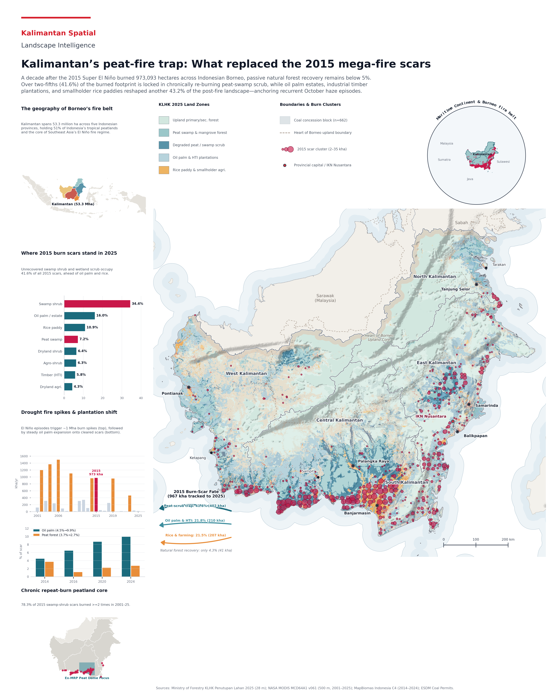
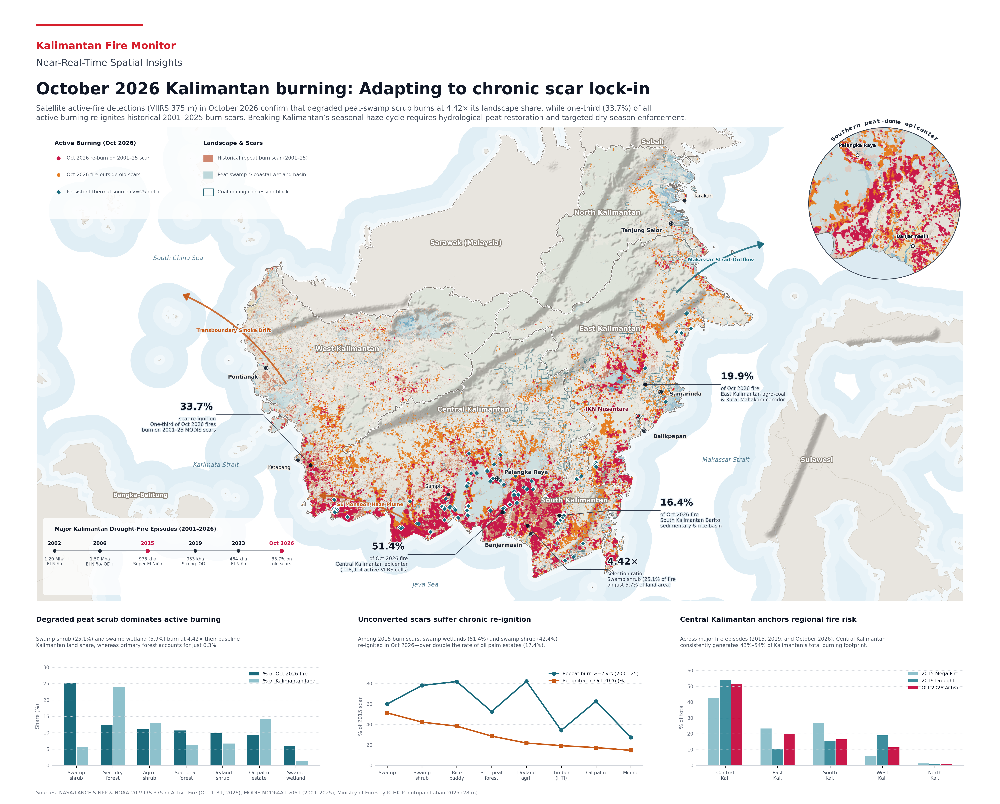
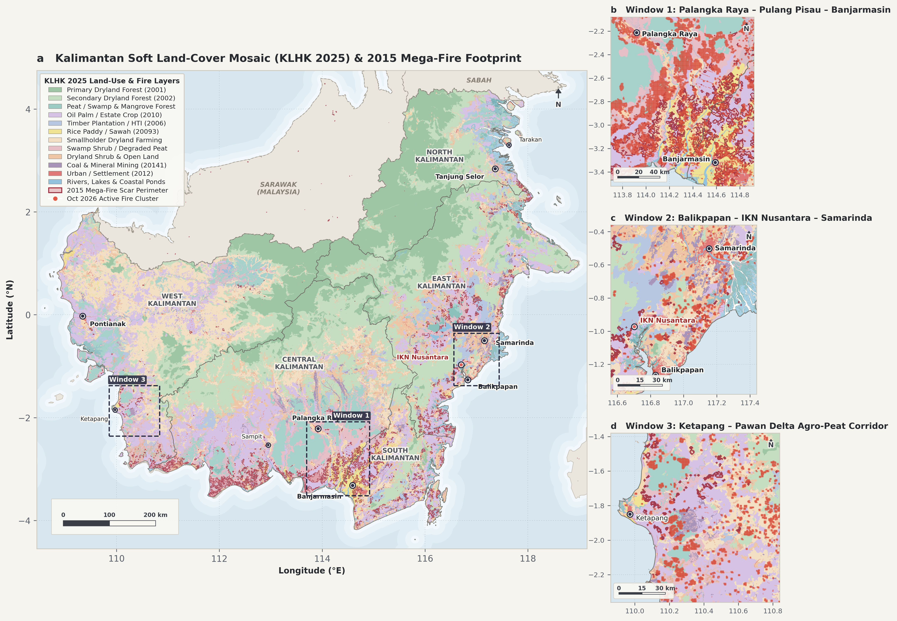
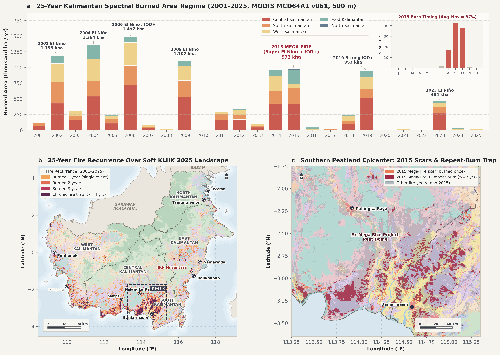
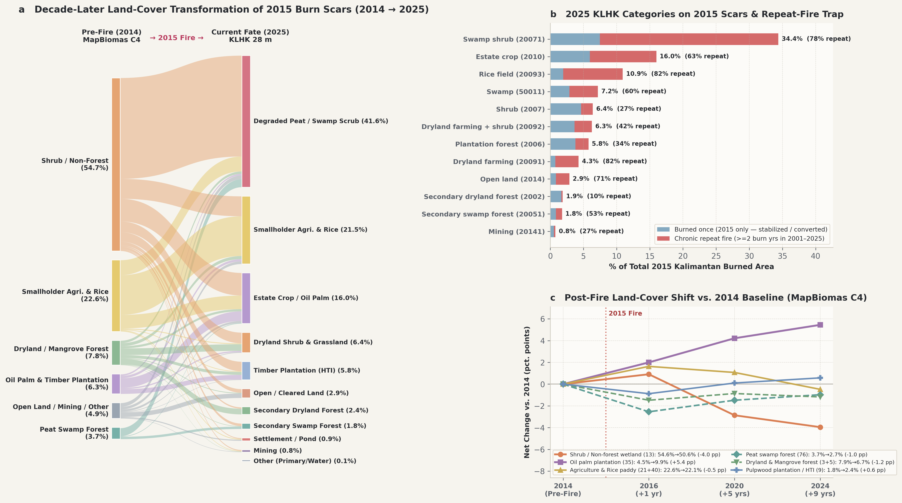
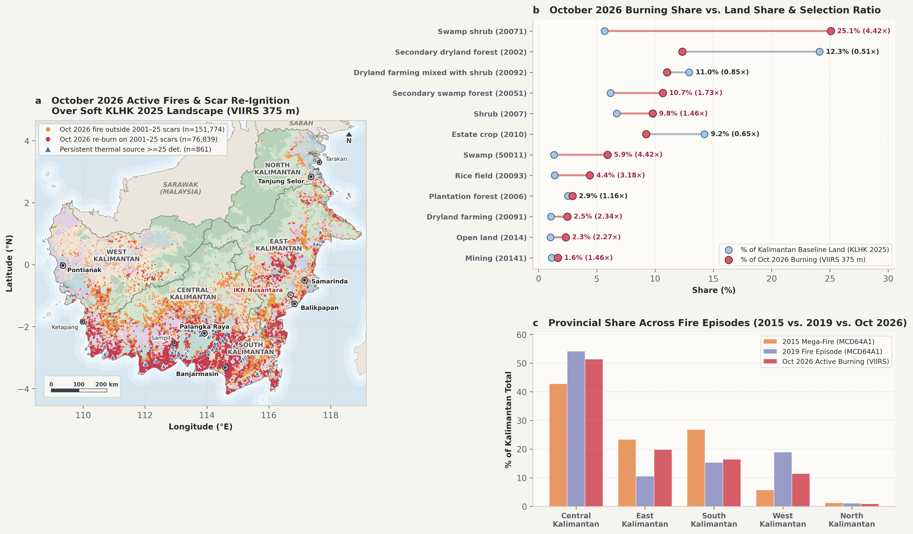

# Kalimantan Fire Regimes, Post-2015 Mega-Fire Trajectories, and October 2026 Active Burning

[](requirements.txt)
[-2E7D32)](#data-sources)
[-D9381E)](#data-sources)
[-F59E0B)](#data-sources)

Spatial analysis of **25 years of landscape fire regimes in Kalimantan, Indonesia (`2001–2025`)**, tracing **what land cover replaced the catastrophic 2015 El Niño mega-fire scars a decade later (`KLHK Penutupan Lahan 2025` & `MapBiomas Collection 4`)**, and diagnosing how historical burn scars drive **October 2026 active burning**.

---

## Key Empirical Findings

1. **25-Year Fire Regime (`2001–2025`, MODIS `MCD64A1` 500 m):**
   - Between 2001 and 2025, **5.42 million ha (`54,197 km²`, `10.2%` of Kalimantan's land mass)** burned at least once.
   - In the post-2010 era, the **2015 Super El Niño + Positive IOD mega-fire** was the single largest catastrophe (**`973,093 ha`** spectral burned area; `96.7%` concentrated in August–October 2015), alongside the **2014** (`962,863 ha`), **2019** (`952,985 ha`), and **2023** (`464,243 ha`) drought episodes.

2. **Where Are the 2015 Mega-Fire Scars Today? (`KLHK Penutupan Lahan 2025`, 28 m):**
   - **Arrested Succession / Chronic Peat-Scrub Fire Trap (`41.56%` / `401,867 ha`):** Over two-fifths of the 2015 burned footprint remains unrecovered **`Semak belukar rawa` (`Swamp shrub`, `34.37%`)** and **`Rawa` (`Swamp`, `7.19%`)**. Within these degraded swamp-scrub scars, **`75.1%` burned in multiple years (`>= 2×`)** and **`43.9%` re-ignited during October 2026**.
   - **Smallholder Agriculture & Rice Mosaic (`21.45%` / `207,443 ha`):** Comprising `Sawah` (`Rice field`, `10.91%`), `Pertanian lahan kering campur semak` (`6.27%`), and `Pertanian lahan kering` (`4.27%`), characterized by high seasonal repeat burning (`70.3%`).
   - **Commercial Plantation Expansion (`21.75%` / `210,366 ha`):** **`Perkebunan` (`Estate crop`, `15.99%`)** and **`Hutan tanaman` (`HTI / Pulpwood`, `5.76%`)**. Cross-referencing `MapBiomas Collection 4` confirms **Oil Palm (`class 35`) more than doubled on 2015 burn scars**, rising from **`4.47%` pre-fire (`2014`) to `9.92%` post-fire (`2024`)**, after which October 2026 fire recurrence dropped to `17.4%`.
   - **Minimal Natural Forest Recovery (`4.27%` / `41,291 ha`):** Only `1.86%` is classified as `Secondary dryland forest` (`2002`) and `1.78%` as `Secondary swamp forest` (`20051`) in 2025, demonstrating near-zero passive forest regeneration on burned peatlands.

3. **October 2026 Active Burning & 11-Year Fire Memory (`VIIRS 375 m` S-NPP + NOAA-20):**
   - Degraded peat/wetland ecosystems (`Swamp shrub 20071`: **`25.09%`**, `Secondary swamp forest 20051`: **`10.66%`**, `Swamp 50011`: **`5.92%`**) account for **`41.67%` of Kalimantan's October 2026 fire footprint** (`Selection Ratio = 4.42×` for swamp shrub) despite occupying only `13.19%` of Kalimantan's land area.
   - **`Central Kalimantan` accounts for `51.37%`** of all October 2026 burning, followed by `East Kalimantan` (`19.86%`), `South Kalimantan` (`16.42%`), `West Kalimantan` (`11.43%`), and `North Kalimantan` (`0.92%`).
   - **One-third (`33.68%`) of all October 2026 burning occurs directly on historical `2001–2025` MODIS burn scars**, confirming strong spatial lock-in of Kalimantan's fire crisis.

---

## Editorial Cartographic Showcase (S&P Global Style)

### A. Post-2015 Mega-Fire Legacy & Peat-Scrub Lock-In (Portrait Infographic Spread)


### B. October 2026 Active Burning & Chronic Burn-Scar Reality (Landscape Infographic Spread)


---

## Analytical & Multi-Scale Atlas Figures

### 1. Multi-Scale Soft Land-Use & Fire Legacy Atlas (`KLHK 2025` × `2015 Scars` × `Oct 2026 Active Fires`)


### 2. 25-Year Kalimantan Fire Regime & Southern Peatland Epicenter (`2001–2025`)


### 3. Post-Fire Fate of 2015 Mega-Fire Scars (`2014 Pre-Fire → 2015 Fire → 2025 KLHK`)


### 4. October 2026 Active Burning Diagnostics & Historical Scar Re-Ignition


---

## Summary Tables

### A. Current (2025) Land Cover of 2015 Mega-Fire Scars (`966,977 ha` Mapped on KLHK PL2025)

| Code | KLHK 2025 Category (ID) | Category (EN) | 2015 Burned Area (ha) | Share of 2015 Scars (%) | Repeat-Burned `>=2 yrs` (%) | Re-Ignited in Oct 2026 (%) |
|---:|---|---|---:|---:|---:|---:|
| `20071` | Semak belukar rawa | Swamp shrub | 332,377.7 | **34.37%** | 78.28% | 42.35% |
| `2010` | Perkebunan | Estate crop (Oil palm / plantation) | 154,656.3 | **15.99%** | 62.80% | 17.42% |
| `20093` | Sawah | Rice field | 105,513.3 | **10.91%** | 82.07% | 38.43% |
| `50011` | Rawa | Swamp | 69,489.3 | **7.19%** | 60.06% | 51.41% |
| `2007` | Semak belukar | Shrub | 61,905.7 | **6.40%** | 27.31% | 20.54% |
| `20092` | Pertanian lahan kering campur semak | Dryland farming mixed with shrub | 60,673.8 | **6.27%** | 41.69% | 21.44% |
| `2006` | Hutan tanaman | Plantation forest (HTI) | 55,709.3 | **5.76%** | 34.30% | 19.36% |
| `20091` | Pertanian lahan kering | Dryland farming | 41,255.9 | **4.27%** | 82.31% | 21.91% |
| `2014` | Tanah terbuka | Open land | 27,797.1 | **2.87%** | 70.57% | 19.03% |
| `2002` | Hutan lahan kering sekunder | Secondary dryland forest | 18,031.9 | **1.86%** | 10.15% | 29.90% |
| `20051` | Hutan rawa sekunder | Secondary swamp forest | 17,209.1 | **1.78%** | 52.69% | 28.68% |
| `20141` | Pertambangan | Mining | 7,406.6 | **0.77%** | 27.50% | 14.75% |
| — | *All remaining 11 classes* | *Mangrove, Settlement, Water, Primary forest* | 14,951.2 | **1.55%** | — | — |

*(Full 23-class table in [`data/processed/megafire_2015_fate_klhk2025_summary.csv`](data/processed/megafire_2015_fate_klhk2025_summary.csv))*

### B. October 2026 Active Burning Share per KLHK 2025 Category (`VIIRS 375 m` & `MODIS 1 km`)

| Code | KLHK 2025 Category (ID) | Category (EN) | % of Oct 2026 Burning (VIIRS 375 m) | % of Repeat Detections | % of Oct 2026 Burning (MODIS 1 km) | % of Kalimantan Land | Selection Ratio |
|---:|---|---|---:|---:|---:|---:|---:|
| `20071` | Semak belukar rawa | Swamp shrub | **25.09%** | 32.47% | 22.86% | 5.67% | **4.42×** |
| `2002` | Hutan lahan kering sekunder | Secondary dryland forest | **12.33%** | 7.78% | 10.37% | 24.11% | 0.51× |
| `20092` | Pertanian lahan kering campur semak | Dryland farming mixed with shrub | **11.03%** | 5.60% | 10.46% | 12.92% | 0.85× |
| `20051` | Hutan rawa sekunder | Secondary swamp forest | **10.66%** | 18.70% | 12.13% | 6.18% | **1.73×** |
| `2007` | Semak belukar | Shrub | **9.79%** | 6.39% | 9.91% | 6.71% | **1.46×** |
| `2010` | Perkebunan | Estate crop | **9.24%** | 8.05% | 13.21% | 14.23% | 0.65× |
| `50011` | Rawa | Swamp | **5.92%** | 6.03% | 5.22% | 1.34% | **4.42×** |
| `20093` | Sawah | Rice field | **4.41%** | 2.78% | 3.24% | 1.39% | **3.18×** |
| `2006` | Hutan tanaman | Plantation forest (HTI) | **2.91%** | 2.64% | 3.22% | 2.52% | 1.16× |
| `20091` | Pertanian lahan kering | Dryland farming | **2.48%** | 3.34% | 2.47% | 1.06% | **2.34×** |
| `2014` | Tanah terbuka | Open land | **2.34%** | 2.35% | 2.66% | 1.03% | **2.27×** |
| `20141` | Pertambangan | Mining | **1.65%** | 2.58% | 1.75% | 1.13% | **1.46×** |
| — | *All remaining 11 classes* | *Primary forest (`0.27%`), Water, Built-up, etc.* | **2.15%** | 1.28% | 2.51% | 21.71% | 0.10× |

*(Full 23-class table in [`data/processed/oct2026_kalimantan_fire_by_klhk2025_complete.csv`](data/processed/oct2026_kalimantan_fire_by_klhk2025_complete.csv))*

---

## Repository Structure

```text
kalimantan-fire-dynamics/
├── README.md                                   # Project overview, findings, embedded figures & tables
├── LICENSE                                     # MIT License
├── requirements.txt                            # Reproducible Python environment dependencies
├── .env.example                                # Template for GEE & local raster directory configuration
├── .gitignore                                  # Excludes raw GeoTIFFs (>50 MB) and credentials
├── data/
│   ├── reference/                              # Kalimantan, Sarawak/Sabah & archipelago GeoJSONs + KLHK/MapBiomas legends
│   ├── raw/                                    # Git-ignored satellite GeoTIFFs (see data/raw/README.md)
│   └── processed/                              # Clean analytical CSV tables tracked in Git
├── scripts/
│   ├── 01_klhk2025_baseline.py                 # Geodesic baseline area across 68 Kalimantan KLHK tiles
│   ├── 02_fetch_gee_datasets.py                # Google Earth Engine downloader (VIIRS, FIRMS, MCD64A1, MapBiomas)
│   ├── 03_oct2026_fire_analysis.py             # October 2026 active fire × KLHK 2025 28 m cross-tabulation
│   ├── 04_megafire_2015_fate_analysis.py       # 2001–2025 regime & 2015 mega-fire post-fire fate analysis
│   ├── 05_generate_publication_figures.py      # Soft pastel urban-atlas cartographic engine (Figures 1–4, 300 DPI)
│   └── 06_generate_sp_global_infographics.py   # S&P Global-style editorial infographic spreads (300 DPI)
└── figures/
    ├── sp_infographic_1_megafire_2015_legacy.png
    ├── sp_infographic_2_oct2026_fire_reality.png
    ├── fig1_kalimantan_25yr_fire_history_and_scars.png
    ├── fig2_2015_megafire_postfire_fate_2025.png
    ├── fig3_oct2026_active_burning_and_fire_memory.png
    └── fig4_kalimantan_soft_landcover_fire_atlas.png
```

---

## Reproducing the Workflow

1. **Install dependencies:**
   ```bash
   pip install -r requirements.txt
   ```
2. **Configure environment paths** (copy `.env.example` to `.env` or set environment variables for Google Earth Engine and `KLHK_PL2025_TILES_DIR`).
3. **Run the pipeline sequentially:**
   ```bash
   python scripts/01_klhk2025_baseline.py
   python scripts/02_fetch_gee_datasets.py
   python scripts/03_oct2026_fire_analysis.py
   python scripts/04_megafire_2015_fate_analysis.py
   python scripts/05_generate_publication_figures.py
   python scripts/06_generate_sp_global_infographics.py
   ```

---

## Data Sources & Methodological Notes

* **KLHK Penutupan Lahan 2025 (`~28 m`, `EPSG:4326`):** Ministry of Forestry (*Kementerian Kehutanan*, Ditjen PKTL) 1:50,000 23-class national land-cover mosaic (68 tiles intersecting Kalimantan; `532,856.55 km²` classified land). Geodesic pixel areas are computed row-wise on the authalic sphere ($R = 6{,}371{,}007.18\text{ m}$).
* **MODIS Burned Area (`MODIS/061/MCD64A1`, `500 m`):** Monthly global spectral burn-scar product (`2001–2025` complete calendar years + Jan–Sep `2026`). Used for historical burned-area accounting because spectral surface-reflectance change accurately delineates post-fire burn scars without thermal blooming.
* **VIIRS Active Fire (`NASA/LANCE/SNPP_VIIRS/C2` & `NOAA20_VIIRS/C2`, `375 m`):** Near-real-time active thermal anomalies (`Nominal` + `High` confidence) for October 1–31, 2026 (prior to `MCD64A1` October 2026 publication). Note that 375 m active-fire swath footprints reflect thermal-anomaly zones rather than net post-fire burn-scar polygons; class percentages (`%`) are cross-validated against 375 m cell centroids and 1 km MODIS `FIRMS`.
* **MapBiomas Indonesia Collection 4 v2 (`2014`, `2016`, `2020`, `2024`):** Used to resolve pre-fire (`2014`) baseline cover and separate `Oil palm (35)` from `Pulpwood plantation (9)` on 2015 burn scars.
